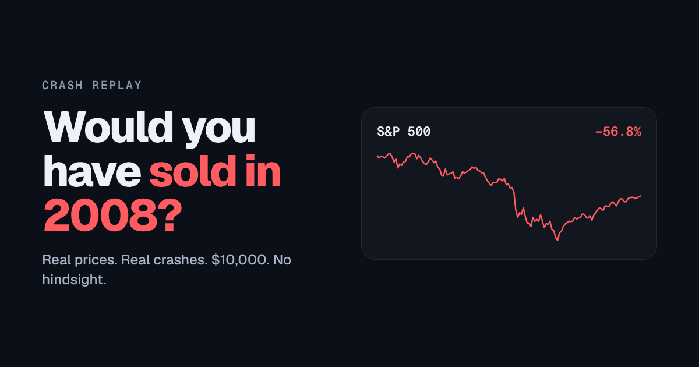

# Crash Replay

[](https://github.com/parveen06naresh/crash-replay/actions/workflows/ci.yml)

Relive the biggest stock market crashes one trading day at a time with $10,000 and real prices. Sell, hold or buy the dip, then see whether you beat buy-and-hold, a rules-based quant strategy, and 2,000 random traders.

**Play:** https://parveenkumar.site/crash-replay (new secret crash every day)

[](https://parveenkumar.site/crash-replay)

| Crash | Index | Window | Peak to bottom |
|---|---|---|---|
| 2008 Financial Crisis | S&P 500 | Jun 2007 – Dec 2009 | −57% |
| Black Monday | S&P 500 | Jun 1987 – Mar 1988 | −34% |
| Dot-com Bust | Nasdaq Composite | Oct 1999 – Dec 2002 | −78% |
| COVID Crash | S&P 500 | Dec 2019 – Dec 2020 | −34% |
| Rate Shock | Nasdaq Composite | Sep 2021 – Jun 2023 | −36% |
| Oil Shock | S&P 500 | Oct 1972 – Jun 1975 | −48% |
| Debt-Ceiling Scare | S&P 500 | Apr 2011 – Feb 2012 | −19% |
| Mystery Crash | S&P 500 | random 252-day window since 1955 with a 15%+ fall, dates hidden | varies |

**After every game:** a move-by-move review (what each trade made or cost you against not trading, with your best and worst move), trophies, and a challenge link (`#2008/vs/21.5`) that drops a friend into the same crash with your score to beat.

**Daily Challenge:** everyone gets the same secret crash each day (UTC), one shot, with a spoiler-free emoji grid to share and a streak counter.

## How the scoring works

- **No look-ahead.** A position chosen at a day's close earns the next day's return.
- **Realistic accounting.** Each trade costs 5 bp of traded value. Cash earns that day's 3-month Treasury bill rate (FRED `DGS3MO`, `TB3MS` before 1981). S&P 500 positions accrue dividends from Robert Shiller's monthly dividend series. Nasdaq scenarios are price-only.
- **The quant.** A classic trend-following rule set: invested only while the index is above its 200-day average, sized to target 15% annualised volatility using 20-day realised volatility. Rebalances when the size moves 10 points or more.
- **The skill test.** 2,000 random traders make exactly as many trades as the player, on random days, to random positions. The share the player beats is a permutation-test score; beating 95% means the timing was unlikely to be luck (p < 0.05).

## Layout

```
scripts/fetch_data.py   downloads raw index (Yahoo Finance, Stooq fallback) and FRED series
scripts/build_data.py   builds web/data.js (compact daily closes, cash and dividend yields)
scripts/bundle.py       inlines everything into dist/crash-replay.html (one self-contained file)
web/engine.js           portfolio accounting, quant strategy, skill test (no DOM, testable in Node)
web/index.html          the app (vanilla JS + canvas, no frameworks)
tests/engine.test.mjs   engine tests: real historic days, costs, no look-ahead, quant, skill test
```

Rebuild: `python scripts/fetch_data.py && python scripts/build_data.py && python scripts/bundle.py`.

Test: `node --test 'tests/*.test.mjs'` (Node 20+). CI runs the tests, checks `web/data.js` rebuilds byte-for-byte from the raw data, and builds the bundle on every push. A monthly workflow refreshes the market data.

Data: Yahoo Finance index history, FRED (Federal Reserve Bank of St. Louis), Robert Shiller. A student project by Parveen Kumar Naresh Kumar. For learning, not investment advice.
